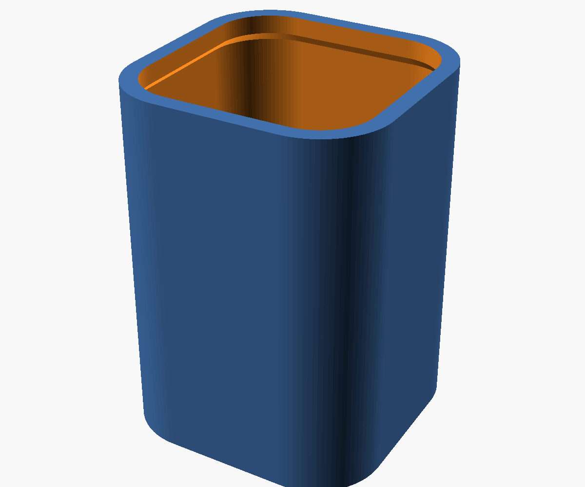

# Snoeppotje voor Meike

Een 3D-printbaar potje voor onder het oude bamboe dekseltje.

## Printen

Open `snoeppotje.stl` in PrusaSlicer. Het potje staat al goed: opening naar boven.

- Materiaal: PLA
- Laaghoogte: 0,2 mm
- Perimeters: 4 (de wand is 1,6 mm, dan is hij helemaal massief)
- Geen support nodig
- Afmetingen: 57 x 57 x 80 mm, ongeveer 200 ml inhoud

## Hoe het past

- Het houten deel onderaan het dekseltje (49 x 49 mm, hoekstraal ca. 11,2 mm)
  zakt in de opening bovenin. Die opening is 49,6 mm, dus 0,3 mm speling per kant.
- De platte siliconen ring (buitenmaat 57 mm) rust op de rand van het potje en
  dicht zo af. De buitenkant van het potje is ook 57 mm, dus de ring loopt gelijk.
- Onder de kraag wordt het potje binnenin iets wijder, met een schuine overgang
  van 45 graden zodat het zonder support print.

## Aanpassen

`snoeppotje.scad` is het bronbestand voor [OpenSCAD](https://openscad.org) (gratis).
Bovenin staan alle maten, zoals `hoogte`, `wand` en `speling`. Na aanpassen:
F6 (renderen), daarna F7 (STL exporteren), en die STL open je weer in PrusaSlicer.

Past het dekseltje te strak, zet `speling` dan op 0.4 of 0.5. Zit het te los, op 0.2.
